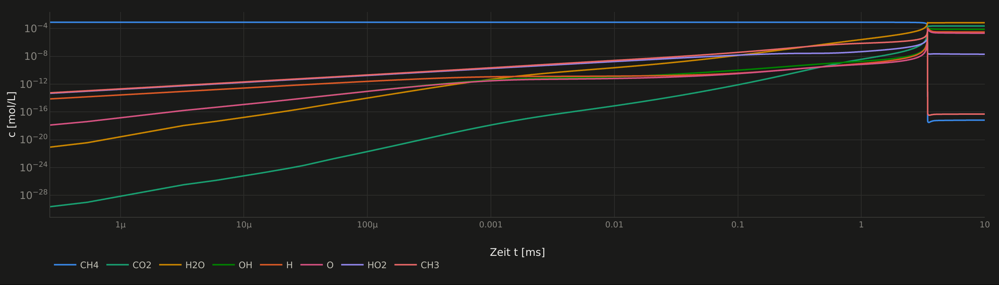
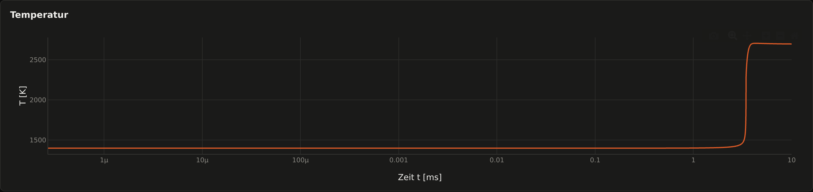
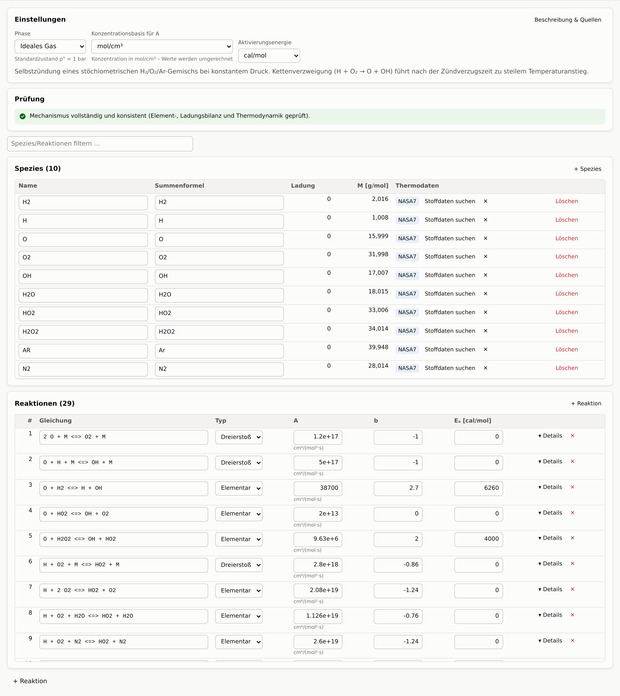
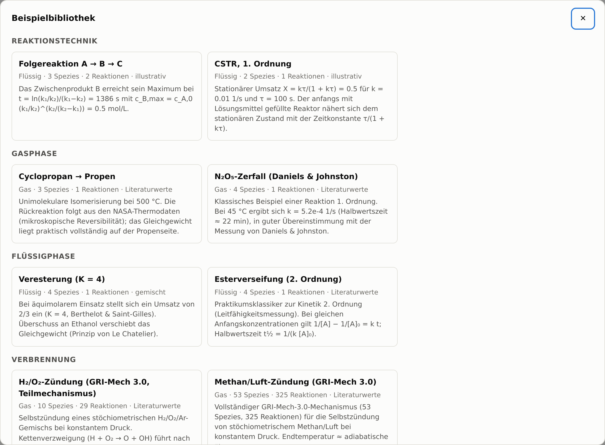
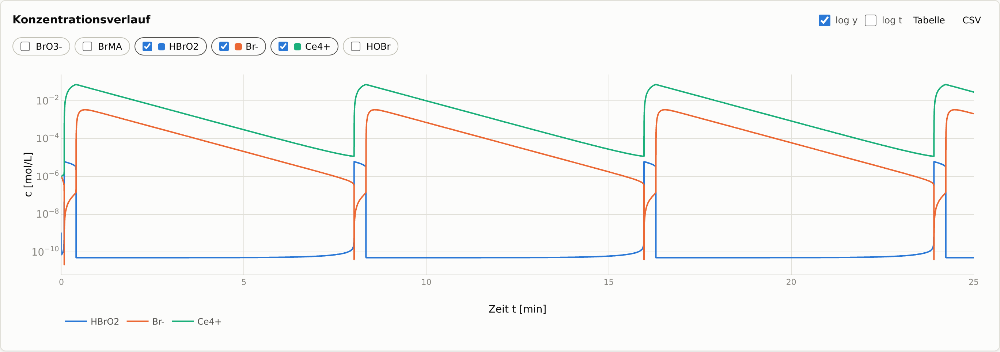
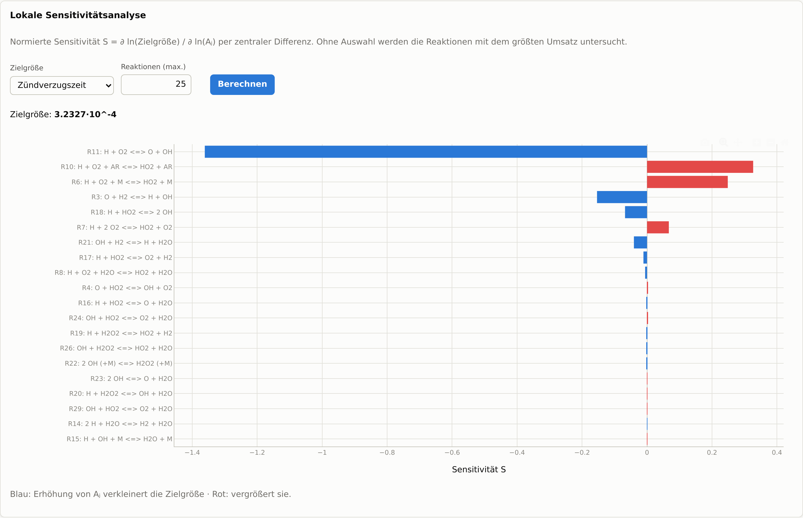
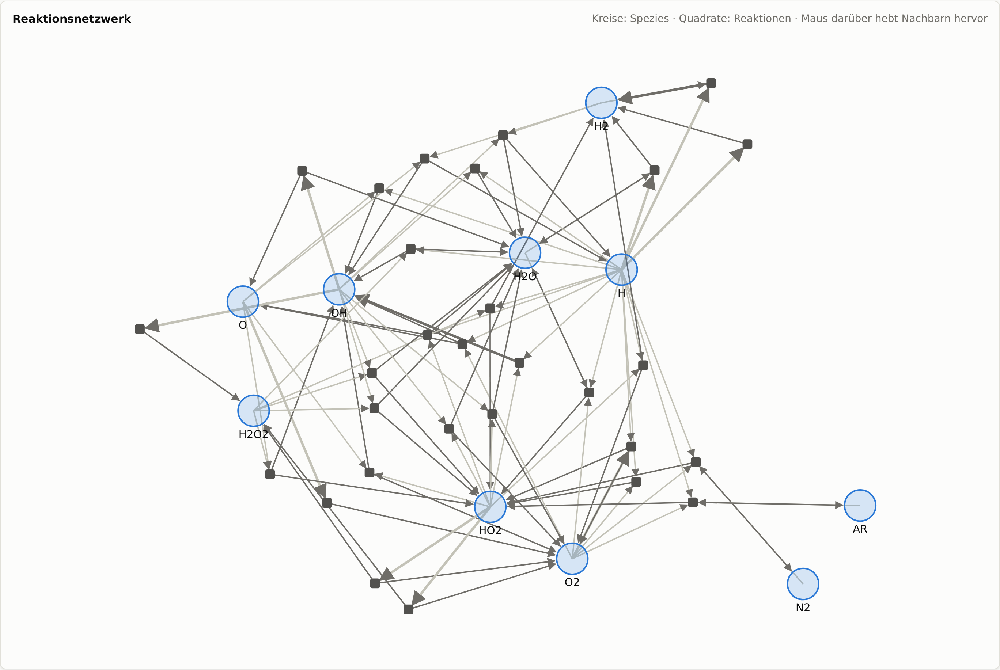
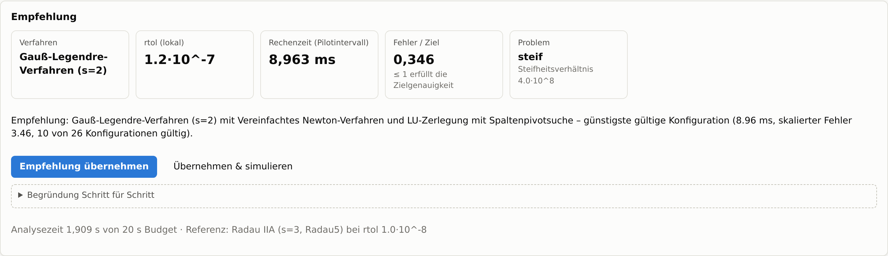
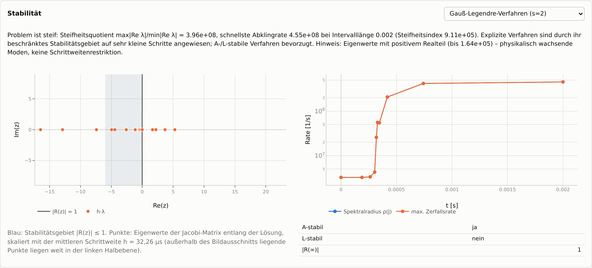
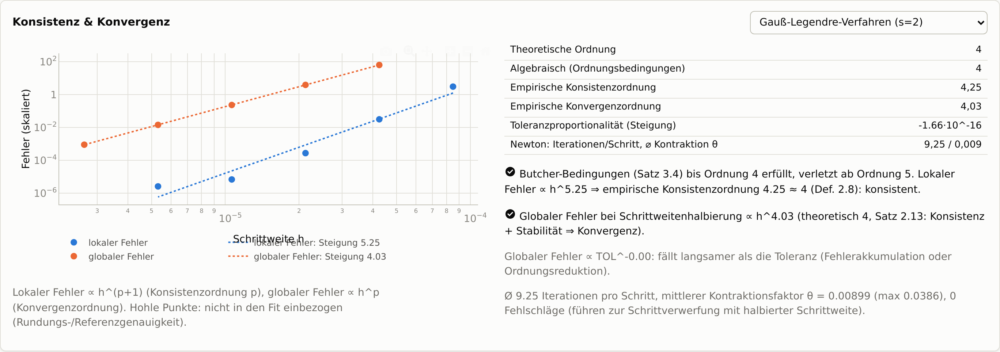

# AutoKinetics

**Chemische Reaktionen im Browser simulieren – von der Esterverseifung im Praktikum bis zur Methan-Zündung mit 325 Elementarreaktionen.**

Reaktionen eintippen, Startbedingungen wählen, auf *Simulieren* klicken: AutoKinetics rechnet aus, wie sich Konzentrationen, Temperatur und Druck über die Zeit entwickeln – und erklärt dabei, *warum* es so rechnet, wie es rechnet.



<p align="center"><i>Selbstzündung von Methan in Luft (GRI-Mech 3.0, 53 Stoffe, 325 Reaktionen): Radikale wachsen über zehn Größenordnungen, bis das Gemisch nach 3,4 ms zündet.</i></p>



---

## Was man damit machen kann

### Reaktionen einfach hinschreiben
Gleichungen wie `2 H2 + O2 => 2 H2O` oder `N2O4 <=> 2 NO2` eingeben – fehlende Stoffe werden automatisch angelegt. AutoKinetics prüft sofort, ob die Atome und Ladungen aufgehen, und zeigt bei jeder Geschwindigkeitskonstante die passende Einheit an.



### 13 Beispiele zum Ausprobieren
Vom Klassiker der Kinetik 1. Ordnung (N₂O₅-Zerfall) über Enzymkinetik und thermisches Durchgehen eines Reaktors bis zur Verbrennung – alle mit Literaturquellen.



### Chemie, die sich bewegt
Die Belousov-Zhabotinsky-Reaktion oszilliert von selbst – hier simuliert mit dem Oregonator-Modell:



### Verstehen, was passiert
- **Sensitivitätsanalyse:** Welche Reaktion steuert das Ergebnis? Bei der Wasserstoff-Zündung ist es eindeutig die Kettenverzweigung H + O₂ → O + OH.
- **Reaktionsflüsse:** Welche Reaktion bildet oder verbraucht einen Stoff wie stark?
- **Gleichgewicht:** Wo landet die Reaktion am Ende – inklusive adiabatischer Flammentemperatur.
- **Netzwerk-Ansicht:** Der ganze Mechanismus als Graph.





### Eigene Messdaten auswerten
Messreihe einfügen und AutoKinetics bestimmt Reaktionsordnung, Arrhenius-Parameter (mit Konfidenzintervall) oder passt die Geschwindigkeitskonstanten des Modells direkt an die Daten an.

### Stoffdaten automatisch nachschlagen
Ein Klick auf *Stoffdaten suchen* holt Summenformel und Molmasse aus **PubChem** und Thermodaten aus dem **NIST Chemistry WebBook** – offline aus der mitgelieferten **NASA-Thermodatenbank**.

### Der passende Löser – automatisch
Chemische Systeme sind oft *steif*: Manche Reaktionen laufen in Nanosekunden, andere über Stunden. Der Numerik-Bereich untersucht das Problem (Stabilität, Konsistenz, Konvergenz), probiert verschiedene Verfahren aus und empfiehlt das schnellste, das genau genug ist – mit nachvollziehbarer Begründung und einem Klick zum Übernehmen.







---

## Stimmen die Ergebnisse?

Jede Version wird automatisch gegen die Realität geprüft – unter anderem:

- **Vergleich mit Cantera**, dem Standardwerkzeug der Verbrennungsforschung: Reaktionsraten stimmen bis auf 10⁻¹⁰, Zündverzugszeiten auf 0,2 % überein.
- **Adiabatische Flammentemperatur** von Methan/Luft: 2225,5 K (Literatur ≈ 2226 K).
- **Analytische Lösungen** (1. und 2. Ordnung, Folgereaktionen, Rührkessel) werden auf 7 Stellen genau getroffen.
- **Erhaltungssätze:** Atome, Masse und Energie bleiben erhalten.
- **Thermodynamik:** Jede Simulation läuft langfristig genau ins chemische Gleichgewicht; K_p von N₂O₄ ⇌ 2 NO₂ ≈ 0,15 wie im Lehrbuch.

---

## Starten

**Mit Docker (am einfachsten):**

```bash
docker compose up --build
```
Dann <http://localhost:8000> öffnen.

**Ohne Docker** (Python ≥ 3.10, Node.js, C++-Compiler):

```bash
python -m venv .venv && . .venv/bin/activate
pip install -e ".[dev]"
(cd frontend && npm ci && npm run build)
autokinetics serve
```

**Auf der Kommandozeile:**

```bash
autokinetics examples                                  # Beispiele auflisten
autokinetics example methane_air_gri30 --out ergebnis.csv
autokinetics lookup ethanol                            # Stoffdaten nachschlagen
```

---

## Für Entwickler

<details>
<summary>Aufbau, Technik und Tests</summary>

**Aufbau**

```
frontend/                React + TypeScript + Plotly (Oberfläche)
src/autokinetics/api     REST-API (FastAPI), Rechenjobs in eigenen Prozessen
src/autokinetics/        Mechanismen (Cantera-YAML), Thermodynamik, Reaktoren, Gleichgewicht, Analyse
src/autokinetics/numerics/  Löser-Auswahl, Stabilitäts-/Konsistenz-/Konvergenzanalyse
src/autokinetics/data/   PubChem, NIST WebBook, NASA-Datenbank
cpp/                     C++-Kern: Kinetik mit analytischer Jacobi-Matrix, Integratoren,
                         lineare Algebra – eingebunden über Cython
```

**Kinetik:** Cantera-kompatible YAML-Mechanismen (NASA-7/9, Shomate; Elementar-, Dreierstoß-, Fall-off- (Lindemann/Troe/SRI) und PLOG-Reaktionen), Import alter `.kin`-Dateien. Reaktoren: Batch bei konstantem Volumen oder Druck, isotherm / Temperaturprogramm / adiabat / gekühlt, Rührkessel (CSTR), gepufferte Spezies.

**Numerik:** eigene C++-Integratoren – explizite und implizite Runge-Kutta-Verfahren (Euler, Heun, RK4, Dormand–Prince, Gauß–Legendre, Radau IIA, SDIRK), Rosenbrock, BDF2; Newton-Varianten und Fixpunktiteration; LU, QR, Jacobi, Gauß–Seidel, CG; Eigenwerte per Hessenberg-QR. Details: [docs/NUMERICS.md](docs/NUMERICS.md), [docs/ARCHITECTURE.md](docs/ARCHITECTURE.md).

**Tests:**

```bash
python setup.py build_ext --inplace    # C++ neu bauen
pytest -m "not network"                # ~280 Tests: Physik, Numerik, API
cd frontend && npx vitest run && npx playwright test
```

**Konfiguration** über Umgebungsvariablen: `AUTOKINETICS_WORKERS` (Rechenprozesse), `AUTOKINETICS_MAX_WALL_TIME` (Zeitlimit pro Job in s), `AUTOKINETICS_OFFLINE=1` (keine Online-Abfragen), `AUTOKINETICS_CACHE_DIR`.

</details>

## Quellen & Lizenz

GRI-Mech 3.0 (Smith et al.) und der H₂/O₂-Teilmechanismus stammen aus den Datendateien von Cantera; NASA-Thermodaten: McBride, Gordon & Reno, NASA TM-4513. Lizenz: GPL-3.0-or-later (siehe `LICENSE.md`).
